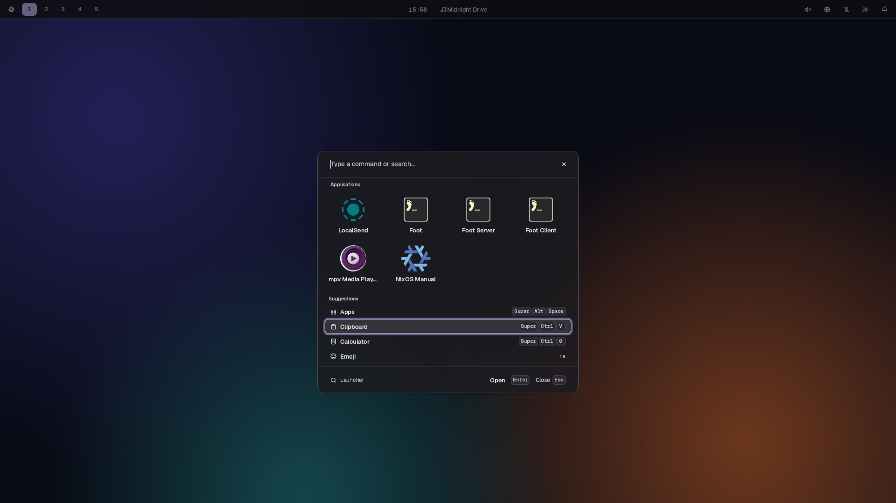
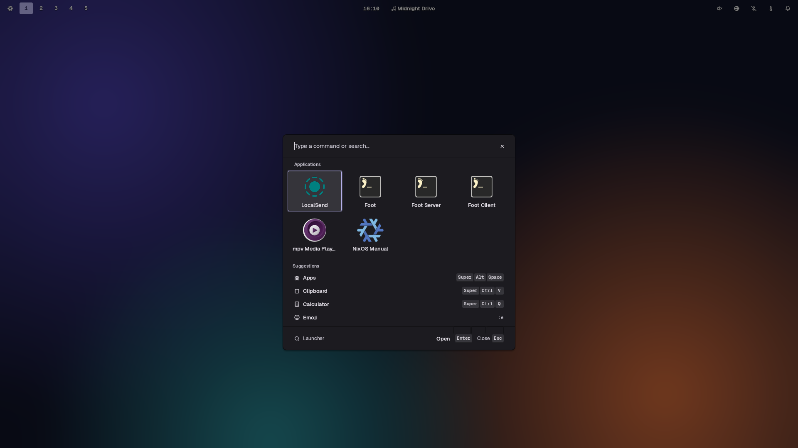
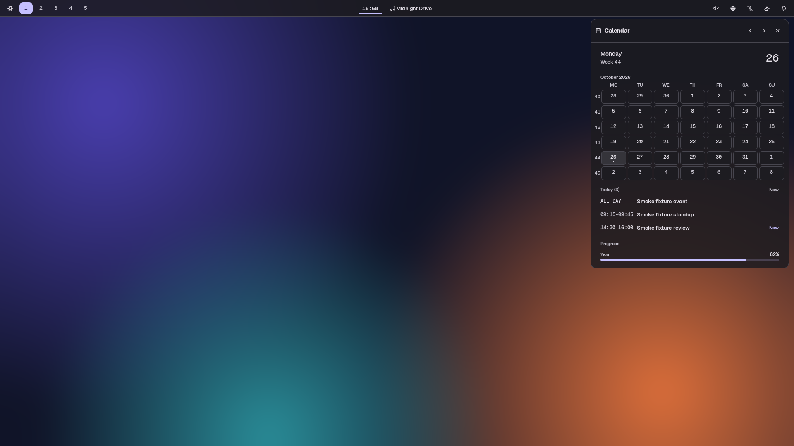
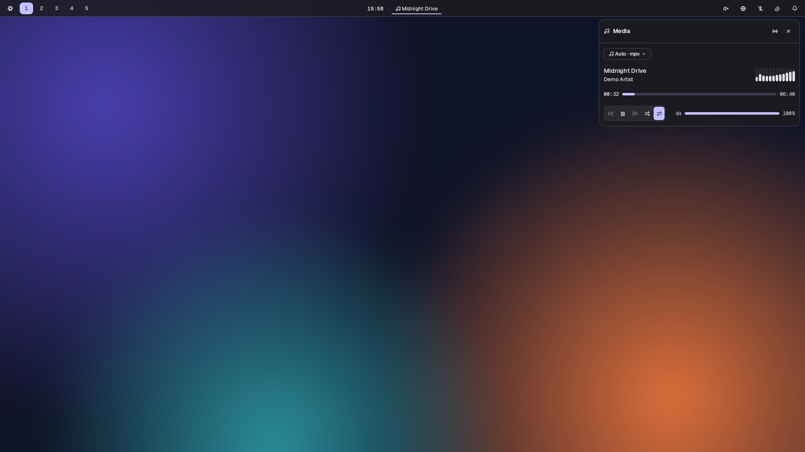
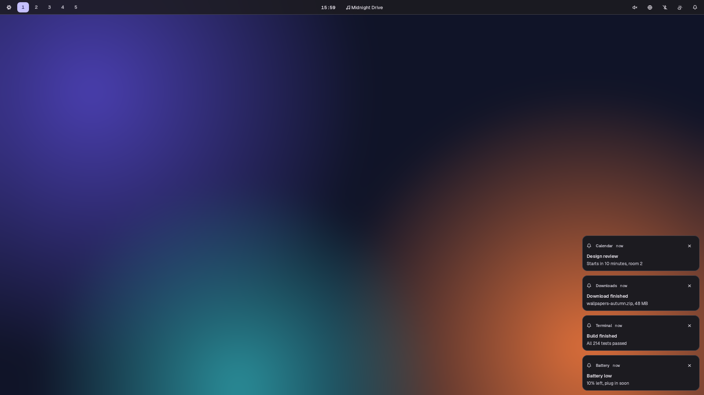
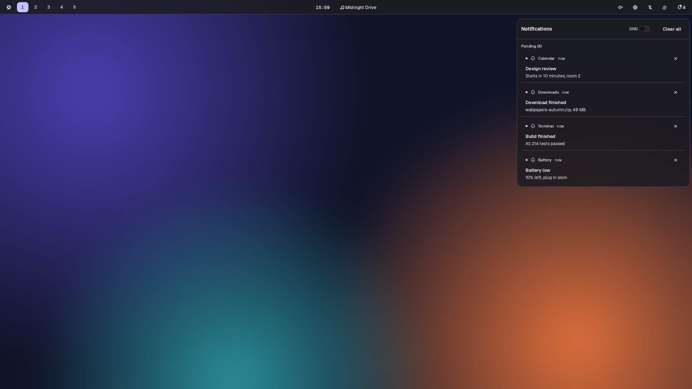
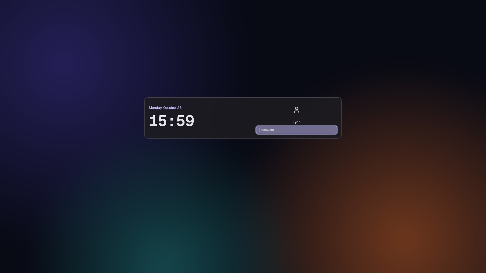
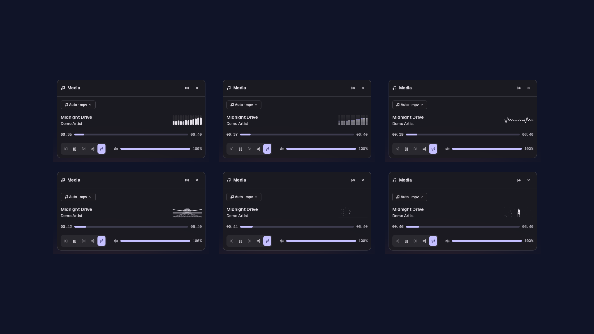
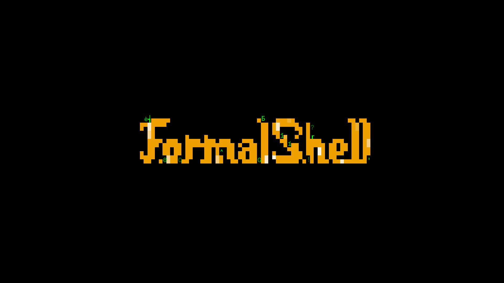

```

  ▄▄▄▄▄▄▄                       ▄▄   ▄▄▄▄▄              ▄▄ ▄▄
 █▀██▀▀▀                         ██ ██▀▀▀▀█▄ █▄          ██ ██
   ██        ▄    ▄              ██ ▀██▄  ▄▀ ██          ██ ██
   ███▀▄███▄ ████▄███▄███▄ ▄▀▀█▄ ██   ▀██▄▄  ████▄ ▄█▀█▄ ██ ██
 ▄ ██  ██ ██ ██   ██ ██ ██ ▄█▀██ ██ ▄   ▀██▄ ██ ██ ██▄█▀ ██ ██
 ▀██▀ ▄▀███▀▄█▀  ▄██ ██ ▀█▄▀█▄██▄██ ▀██████▀▄██ ██▄▀█▄▄▄▄██▄██
```

[](https://github.com/FormalStudio/FormalShell/actions/workflows/ci.yml)
[](crates/)
[](#install)
[](docs/SWITCHOVER.md)
[](LICENSE)

A desktop shell for [Hyprland](https://hypr.land), written in Rust. One
process draws the bar, launcher, panels, notifications, lock screen, greeter
and screensaver, and every colour comes from your wallpaper through matugen. Everything is reachable from the
keyboard and drivable over IPC.

[](docs/shots/launcher.mp4)

**Early, and daily driven.** It has been the session shell on both
development machines since August 2026. [`docs/SWITCHOVER.md`](docs/SWITCHOVER.md)
tracks what has run on real hardware and what has only run in a VM.

## The look

elementary OS 8's material: raised controls, sunken fields, cards on a soft
cast, on a palette that follows the wallpaper.



[](docs/shots/panel.mp4)

## What's in it

- Launcher: apps, clipboard history, calculator, emoji, `nix run`,
  your keybinds, wallpapers, Wi-Fi, Bluetooth, audio devices, radio,
  toggles, and a `select`/`input` mode that replaces dmenu.
- Bar: workspaces with live window previews, now playing, tray, and a
  chevron that tucks cells away into a second bar. Top, bottom, left or right.
- Panels: audio, network, Bluetooth, calendar, weather, power, displays,
  system monitor, media with synced lyrics and 31 visualizer styles, iPhone
  and earbuds, and more.
- Notifications: toasts, a history centre, grouping and DND.
- Alt+Tab switcher with window thumbnails.
- Capture: screenshots with a region picker, screen recording, OCR and a
  colour picker.
- Lock screen and greeter over PAM, and a [ttfx](https://github.com/omacom-io/ttfx)
  screensaver.
- Night light, caffeinate, reminders, polkit agent, LocalSend, AirPlay.

A widget with nothing behind it says so (`NO ADAPTER`, `NO PLAYER`) instead of
inventing data. That holds for every screenshot here. The images and clips in
`docs/shots/` are regenerated with `scripts/shots` (`just shots`).

| | |
| :---: | :---: |
| <br>Now playing | <br>Notifications |
| <br>Notification centre | <br>Lock screen |



[](docs/shots/screensaver.mp4)

## Install

### Arch, Debian, Ubuntu and Fedora

x86_64 and aarch64:

```sh
curl -fsSL https://raw.githubusercontent.com/FormalStudio/FormalShell/main/install.sh | sh
```

It installs Hyprland and the shell's runtime tools with pacman, apt or dnf,
unpacks the latest release under `~/.local` (`--system` for `/usr/local`),
and runs `formalshell install`: the systemd user units, the Hyprland files
(`~/.config/hypr/formalshell.lua`, a `hyprland.lua` that loads it, and your
own `hypr-user.lua`, which already holds any `hyprland.lua` you had), and,
after asking, the lock screen's PAM file and a greetd config for the greeter.
That config either boots you straight into Hyprland behind the lock screen,
the greeter showing only after a logout, or shows the greeter at every boot
(`formalshell install --login autologin|greeter` answers without asking).
A tool your distro does not carry is skipped and its widget says so.
Debian trixie and Fedora carry no Hyprland package, so there you install
Hyprland 0.56 or newer yourself first.

The greeter draws the lock screen's card: the clock, a session chip (every
installed Wayland session, Tab or a click picks one) and power buttons on one
side, the last user's picture, name and password field on the other. A second
login account adds a user chip. It starts on Hyprland and remembers each
user's last session. The lock screen is the same card in its locked state,
with now playing where the chips go.

### Update and uninstall

```sh
formalshell update      # newest release; rewrites only the files the installer owns
formalshell uninstall   # removes the units, the Hyprland files, the PAM file and greetd config
```

`hypr-user.lua` is yours and no update touches it; uninstall moves it back to
`hyprland.lua` and leaves `~/.config/formalshell` and the shell's state in
place. Both take `--yes` to answer the sudo prompts, and `update --from
<tarball>` updates from a local file.

## Usage

| chord | does |
| --- | --- |
| `Super+Space` | launcher |
| `Super+Alt+Space` | apps |
| `Super+Ctrl+V` | clipboard history |
| `Super+Ctrl+E` | emoji |
| `Super+Ctrl+Space` | wallpaper picker |
| `Super+Ctrl+A` / `W` / `B` | audio / network / Bluetooth panel |
| `Super+Ctrl+L` | lock |
| `Print` | screenshot |
| `Alt+Tab` | window switcher |
| `Super+K` | every bind, searchable |

Everything else goes through IPC:

```sh
alias fs='formalshell-ipc call'

fs wallpaper set ~/Pictures/wall.jpg   # recolours the whole desktop
fs theme mode toggle                   # dark / light
fs panel toggle calendar
fs notifications toggleDnd
```

Config is `~/.config/formalshell/settings.json`. The shell only reads it;
its own state goes to `$XDG_STATE_HOME/formalshell/state.json`.

```jsonc
{
  "theme": { "mode": "auto" },
  "bar": { "position": "bottom" }
}
```

[`docs/USAGE.md`](docs/USAGE.md) has every config key, IPC verb and bind.

## Plugins

A plugin is an executable in any language, running as its own process. It
lives in `~/.config/formalshell/plugins/<id>/` beside a `manifest.json`:

```json
{ "apiVersion": 1, "id": "hello", "kind": "bar", "entry": "hello.sh" }
```

`kind` is `bar`, `panel` or `overlay`. The shell starts `entry` in the
plugin's directory and reads one JSON object per line from its stdout, each
replacing the last: `text`, `icon` (an icon name), `tooltip`, `class`, and
`rows` for a panel. Clicks, scrolls and row activations arrive on its stdin
as JSON lines, such as `{"event": "click", "button": "left"}`. A plugin that
exits shows a dim PLUGIN ERROR cell and is started again after a backoff.
While a plugin prints nothing, the shell does no work for it.

```sh
#!/bin/sh
while :; do
  printf '{"text": "%s", "icon": "clock"}\n' "$(date +%H:%M)"
  sleep 60
done
```

## IPC

`formalshell-ipc` talks to the running shell over a Unix socket under
`$XDG_RUNTIME_DIR/formalshell/`. The Hyprland binds use it, and so can your
scripts.

```sh
formalshell-ipc show                      # every target and function
formalshell-ipc call panel toggle audio
formalshell-ipc call media status         # JSON
```

## Development

```sh
just build    # cargo build --release on the Linux build host, ./result laid out as the release
just lint     # clippy and the pure crates' tests
just smoke --menu --showcase
```

The shell is a Cargo workspace under [`crates/`](crates/): `formalshell-rs`
is the binary with its surfaces and services, and the `fs-*` crates hold the
logic underneath (theme tables, launcher ranking, audio, network and so on).

`just smoke` boots the shell in a throwaway nested Hyprland session on a
private D-Bus, drives the surfaces its flags name, screenshots them and tears
down, so the lock screen and notification server never touch your real
session. Each flag is a file under [`dev/smoke.d/`](dev/smoke.d/). It runs on
a Linux build host over ssh (`dev/remote.sh`); `just local-smoke` runs it in
your own session.

## Credits

The architecture and much of
the interaction language come from [Omarchy](https://github.com/basecamp/omarchy)'s
`quattro` branch. Other inspiration came from
[Caelestia](https://github.com/caelestia-dots/shell),
[Noctalia](https://github.com/noctalia-dev/noctalia-shell) and macOS. Service
patterns borrowed from
[DankMaterialShell](https://github.com/AvengeMedia/DankMaterialShell) (MIT,
attributed in each ported file).

MIT licensed. See [`LICENSE`](LICENSE).
